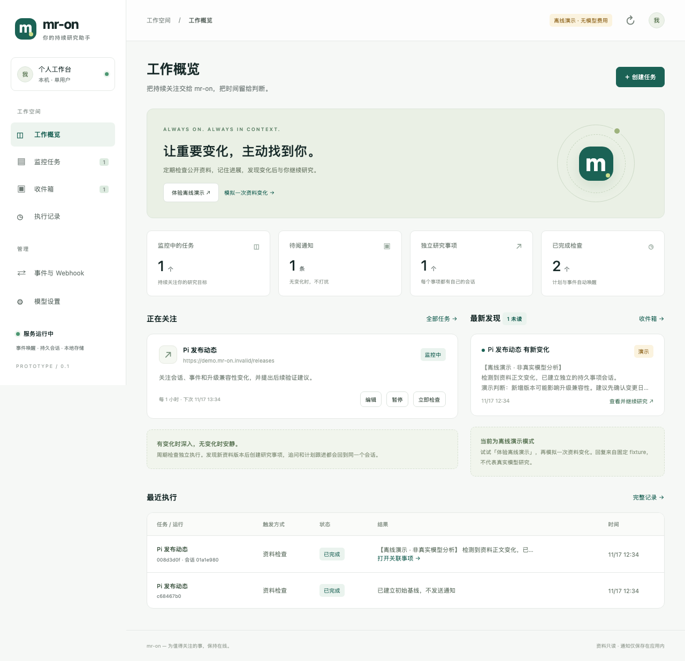

# mr-on

一个可以在本机运行的 Always-on Agent 原型。配置公开资料 URL 和研究目标后，它会按计划或外部事件检查资料，发现新的正文版本时解释影响，放入应用内收件箱。你可以针对这次变化继续追问，也可以安排一次后续分析。

默认中文、单用户、仅监听本机。Node 持久服务负责等待事件，Pi Coding Agent SDK 负责模型执行与持久会话，SQLite 保存业务进度。



## 安装与启动

需要 Node.js **22.19+**（开发验证环境为 Node 26.8.1）和 npm。

```bash
npm ci
npm run build
npm start
```

打开 [本地工作台](http://127.0.0.1:4317)。默认是**离线演示模式**，不需要模型凭据。

需要关闭终端后仍运行，可先构建，再预览后台安装：`npm run service -- install --dry-run`。确认后执行 `npm run service -- install`，由 macOS launchd 或 Linux systemd 用户服务托管。详见 [Gateway 后台服务](docs/gateway-service.md)。安装不会自动开放公网端口。

Web 和 CLI 可共同访问事项与画像会话；CLI 使用独立、可撤销的凭据，支持读取历史和订阅持久事件。用法及协议见 [共享 Channel 接入](docs/channel.md)。

开发时运行 `npm run dev`。退出时按 Ctrl+C；服务会停止接收请求，等待当前运行结束后释放数据库与进程锁。无需公开部署。

可选环境变量：

| 变量         | 默认值  | 用途                           |
| ------------ | ------- | ------------------------------ |
| `PORT`       | `4317`  | 本机监听端口                   |
| `MR_ON_DATA` | `.data` | 数据目录，相对当前工作目录解析 |

```bash
MR_ON_DATA=/absolute/path/to/data PORT=4317 npm start
```

数据目录包含 `state.sqlite`、SQLite WAL 文件、`pi/sessions/`、`webhook-token` 与 `service.lock`。目录权限为 `0700`，数据库与令牌文件为 `0600`。API Key 保存在服务端 SQLite 配置中，**没有应用层加密**；不回传浏览器，不写入应用日志。Pi 使用独立配置目录和内存凭据，不读取用户的全局 Pi 扩展、技能、项目指令或 shell 配置；画像会话仅显式加载随产品发布的 understand-user skill。不要将数据目录加入版本控制。

## 主动认识用户

启动后，首页和收件箱会出现“你好，我想先了解你一点”的邀请。点击“开始交流”进入“关于我”：可以逐轮聊天，也可以切换“一次性填写”。八个方面覆盖背景、目标、兴趣、工作方式、交流偏好、日常节奏、边界与期待帮助；不愿提供的可以跳过。

画像保存用户明确提供的原话，支持修改和删除。关闭主动邀请后仍可随时手动进入。未回答时不会重复催促，稍后提醒为 24 小时，正常更新邀请为七天。SSE 将变化推给已连接客户端，轮询作断线兜底。

产品会显式加载仓库内的 `skills/understand-user`，画像会话没有工具。编辑画像会清理旧画像会话；删除会关闭邀请并删除专属交流历史。研究会话和既有研究结果保留。真实模型模式会按界面说明发送相关自述给配置的服务。

[详细设计与数据边界](docs/user-understanding.md)

## 五分钟离线演示

1. 点击“体验离线演示”，建立演示资料的初始基线。首次读取不会发通知。
2. 点击“立即检查”。资料没有变化，仍然不会通知。
3. 点击“模拟一次资料变化”。应用会更新保存在 SQLite 中的演示正文，通过真实 Pi SDK 和固定 provider fixture 生成一条明确标识的演示结果。
4. 打开收件箱中的变化，输入“升级前应该验证什么？”。回复会复用该事项原有的 Pi 会话。“会话与路由信息”可核对 ID。
5. 在同一详情中安排后续分析，时间选择下一分钟。关闭服务，等计划时间过去后重新启动；计划会执行一次，结果进入收件箱，并复用同一会话。
6. 暂停任务可停止周期唤醒及尚未入队的后续计划；手动执行和已接收的事件仍可触发，当前运行不会被取消。恢复后按新检查周期继续。

只有保留域名 `https://demo.mr-on.invalid/releases` 使用本地资料 fixture。其他公开 URL 即使在离线演示模式下也会真实读取网络资料，模型解释仍为固定演示回复。**离线演示已验证 SDK 的执行、持久会话、压缩与业务路由，没有证明真实在线模型的兼容性或分析质量。**

也可以运行完全不依赖公网的命令行演示：

```bash
npm run demo
```

它使用临时数据目录，演示基线、变化、通知、追问、事件去重、关闭数据库后恢复计划；完成后删除临时目录，不修改你的工作台数据。

## 连接真实模型

打开“模型设置”，选择“真实模型”，填写 HTTPS 服务地址、模型 ID 和 API Key。例如：

- 服务地址：`https://api.openai.com/v1`
- 模型 ID：`gpt-4o-mini`
- API Key：你的服务端凭据

当前适配的是 Pi `openai-completions` API，即 OpenAI 兼容的 Chat Completions 服务，不是 Responses API。模型需支持工具调用和流式回复。保存后，新运行使用新配置；已有运行使用启动时的配置。API Key 输入框留空会保留现有凭据。

创建一个真实公开资料任务并点击“立即检查”以建立基线。下一次正文变化才会调用模型。每个新事项会话可以读取该任务唯一配置的 URL，不能执行 shell、浏览任意文件、发布内容或发送外部消息。只在应用内生成通知。

没有使用真实 API Key 进行在线模型验证。更换服务商时，应先用小资料测试工具调用、流式响应、输出长度及错误处理。

## Webhook 与事件去重

“事件与 Webhook”页面会生成带实际 taskId 的可复制示例。默认配置下，在仓库目录执行：

```bash
TOKEN="$(cat .data/webhook-token)"
curl -X POST http://127.0.0.1:4317/api/webhook \
  -u "events:$TOKEN" \
  -H 'Content-Type: application/json' \
  -d '{"eventId":"release-2026-001","taskId":"替换为任务 ID","payload":{"source":"release-hook"}}'
```

Basic 用户名固定为 `events`，令牌在首次启动时随机生成，重启后保持。事件收件与检查入队在同一个 SQLite 事务中提交，再返回 HTTP 202。同一个全局 `eventId` 再次提交会返回 `duplicate: true`，不会重复执行；若 ID 属于另一任务则拒绝。`payload` 仅作为收件记录保存，不作为模型指令执行。

接口只绑定 `127.0.0.1`，不会直接接收公网 webhook。确有需要时，由你配置带认证的代理或隧道；本项目不自动开放端口。UI API 用 Host、Origin、Fetch Metadata 与 JSON Content-Type 限制跨站请求，webhook 额外要求 Basic 认证。它没有多用户登录体系，也不适合直接暴露到公网。

## 持久化与恢复保证

| 状态或事件                           | 恢复行为                                                                                   |
| ------------------------------------ | ------------------------------------------------------------------------------------------ |
| 周期任务错过多个检查时间             | 下次启动合并成一次补查；之后从当前时间计算下一次检查                                       |
| 到期的一次性 follow-up               | 在任务未暂停时入队一次，保留 itemId 与会话关联                                             |
| 已提交的 queued 运行                 | 重启后继续执行                                                                             |
| 进程终止时正在 running 的运行        | 标记 interrupted，不假装恢复到工具执行现场；执行记录提供手动重试                           |
| 已接收事件重复到达                   | eventId 在数据库中永久去重，不因重启失效                                                   |
| 资料无变化或回到已报告版本           | 代码比较正文 SHA-256，不调用模型，不重复通知                                               |
| 解释失败                             | 不推进资料游标；后续周期检查或手动重试可再次处理                                           |
| 通知写入时崩溃                       | 事项、通知、游标和成功运行状态在一个事务中提交                                             |
| 模型已回复，但业务事务尚未提交就崩溃 | 可能产生未关联事项的 Pi 会话；run 保留会话路径，手动重试可能再次调用模型，但不会有半条通知 |

同一任务的检查与事项追问串行执行。每个事项只属于一个任务，因此其 Pi 会话也不会被同时写入。独立任务最多并发两个。相同数据目录有进程锁，只支持单个服务进程。重试会在同一事务中把原运行标为已重试并关联替代 runId，同一失败运行不能重复重放；如果替代运行再次失败，可对该新运行继续手动重试。

周期检查不会持续追加到用户主对话：基线和无变化检查不建 Pi 会话；每个新正文版本建立一个独立事项会话。之后的追问、通知点击和显式 follow-up 都按数据库 ID 关联，**不依赖模型猜测正在谈论哪个事项**。上下文超过模型窗口的 65% 时调用 SDK `session.compact()`，也启用 SDK 自动压缩；任务游标和计划保存在会话之外。

## 读取与运行边界

- 公开 HTTP/HTTPS 标准端口，文本与 HTML；不支持登录、PDF、JavaScript 渲染页、压缩响应或完整浏览器。
- 所有解析出的 IP 必须为公网单播地址，包括 IPv4 映射 IPv6；连接固定到已校验 IP，TLS 仍校验原域名。最多 4 次重定向，每跳重新校验，拒绝本机、私网、链路本地和特殊地址。
- 单次读取含 DNS 最多 15 秒、响应最多 512,000 字节、正文最多 60,000 字符。超限失败，不对截断内容建立错误基线。空白归一化，并移除 HTML 导航、脚本等元素后比较。
- 每次运行总预算 90 秒、最多 4 个模型 turn、最多 2 次模型工具读取；模型输出上限声明为 2,048 tokens。资料读取最多尝试 2 次，SDK 自动重试最多 1 次，provider 内层重试关闭。
- 网页与工具结果明确标为不可信引用。模型提示不能消除所有提示注入风险；权限边界由工具 allowlist 和 URL 限制落实。
- 当前没有外部写入工具。手动重试只会再次读取与分析，不会发布或发送消息。未来加入有副作用的工具前，需要持久化审批等待状态、带参数摘要的 actionId、明确授权、幂等键与人工对账，不能复用当前的只读重试策略。
- 正文发生任何新变化都会创建研究事项，不做相关性评分或页面局部选择器；频繁变化的网站可能产生较多通知。记录保留在本机，列表显示最近 100 次运行/通知与 300 条消息；这些记录引用的旧事项仍可打开。暂不提供归档、删除或磁盘保留策略。
- “Always-on”依赖 Node 进程和电脑持续运行；进程退出或电脑休眠时不会执行。恢复后按上述规则补查。后台运行可使用内置 `service` 命令安装系统服务管理器配置；宿主机仍需持续运行且网络可用。

## 验证

```bash
npm run build
npm test
npm run demo
npx playwright install chromium
npm run test:ui
npm run format:check
```

单元和集成测试覆盖无变化静默、正文版本去重、重复事件、重启计划、中断状态、会话创建/复用/压缩、同任务串行与独立任务并发、URL 编辑竞态、私网地址拒绝、API 认证与凭据脱敏。Playwright 覆盖中文工作台中的演示、追问、后续计划、任务创建/编辑/暂停/恢复、模型设置与移动布局。浏览器测试使用独立 `.data/ui-test-*` 目录，不碰默认工作台。

[架构决策与 SDK 版本依据](docs/architecture.md) · [事项会话界面](docs/screenshots/research-thread.png)

[PR 检查与审核流程](docs/ci.md)

Telegram private-chat access is available as an opt-in external Channel. See [Telegram setup, commands and delivery guarantees](docs/telegram.md).

## npm 安装与发布

打包命令与仓库脚本的数据目录不同；安装、旧数据路径及手动发布步骤见 [npm 安装与发布](docs/npm-release.md)。
