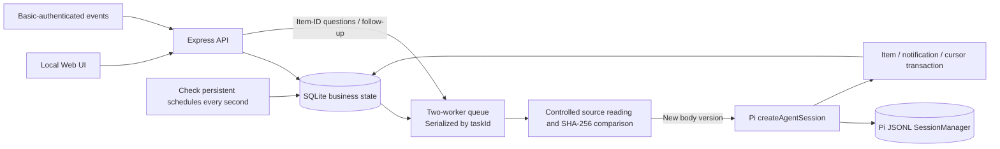

# ADR 001: Validate an always-on agent with the Pi SDK

Status: Prototype implemented. Date: 2026-11-17.

## Decision

Use TypeScript, a persistent Node process, SQLite, and Express, with native HTML/CSS/JS refreshed through a local JSON API every two seconds. The single-user prototype needs no additional frontend build chain, message broker, or separate database service; run it with `npm ci && npm run build && npm start`. Node's built-in SQLite reduces native dependency installation overhead. The minimum version is 22.19, constrained by the Pi SDK engine requirement.

Model execution uses `@earendil-works/pi-coding-agent` **1.5.2** and the matching `@earendil-works/pi-ai` version. package.json pins both exactly, and package-lock.json locks the complete dependency tree. On 2026-11-17, `npm view @earendil-works/pi-coding-agent version` confirmed the installable version. The installed package's `examples/sdk/12-full-control.ts`, `dist/core/sdk.d.ts`, `model-runtime.d.ts`, `provider-composer.d.ts`, and `session-manager.d.ts` then supplied the actual APIs used for compilation and testing.

[Upstream SDK documentation](https://github.com/earendil-works/pi/blob/main/packages/coding-agent/docs/sdk.md) and the user's local references informed capability discovery; mainline documentation did not replace the installed types. In particular, this version uses `ModelRuntime`, tool-name allowlists, and an explicit `ResourceLoader`; older tool-object or AuthStorage examples cannot be applied directly.

## Why start with the SDK

The primary question is whether continuous source monitoring is useful. Tasks, source changes, and user follow-up questions need to work quickly. The SDK supplies `createAgentSession`, native `SessionManager`, streaming events, tool execution, retries, and context compaction, avoiding another model/tool loop implementation. `pi-ai` provides only the provider interface and cannot replace Coding Agent sessions.

Pi Durable is not a second execution engine in this prototype. All initial tools are read-only; interrupted work can be marked explicitly for user retry, and SQLite recovery is sufficient for business scheduling. A heavier durable execution framework would add state boundaries and debugging costs without a currently verifiable product benefit.

Reconsider Pi Durable or another durable execution system when actual tasks require multiprocess workers, execution across machines, long approval waits, precise multistep recovery, or workflows with external side effects. JSONL history alone does not provide tool-level checkpoints.

## State boundaries

- `taskId` remains stable over time and owns the goal, URL, interval, paused state, and current body cursor.
- `runId` identifies a check, question, or scheduled analysis, recording its trigger, state, result, and actual Pi session ID/path.
- `itemId` represents a new body version and its research item. `UNIQUE(taskId, hash)` prevents repeated notifications for the same version.
- Each item has an independent `sessionId/sessionPath`. Baseline and unchanged checks create no session; new items create one, and questions and follow-ups reopen its existing JSONL file.
- notifications and messages explicitly retain task/item/run/session links. The UI opens an item from a notification and sends questions by itemId, without semantic inference.
- The global eventId in events is the receipt idempotency key; receipt and run enqueueing commit in one transaction. followups record absolute dueAt and derived runId values.
- Business state and Pi history do not share a distributed transaction. A new session path is first written to the run; successful results then commit item, notification, cursor, and completion state in one SQLite transaction. A crash can leave an orphan session or duplicate model charges, but cannot advance the cursor without recording its notification.

## Controlled SDK environment

Use an empty workspace under the project data directory, an isolated agentDir, in-memory CredentialStore, and in-memory SettingsManager. A custom ResourceLoader returns no extensions, prompt templates, project instructions, or themes. Research mode loads no skills; profile mode loads only the bundled understand-user skill. The research tool allowlist contains only `read_task_url`, with no arguments; the server supplies the task's actual URL. Default CLI resource discovery is not used, and MCP is not loaded by default.

The offline provider still runs through `ModelRuntime.registerProvider()` and `createAgentSession()`, producing real Pi session files. Its fixed fixture establishes SDK integration and persistent routing, not real provider networking or research quality. Public URL reading had a separate network smoke check; automated tests remain offline by default.

## Scheduling, budgets, and recovery

One service process holds the data-directory PID lock. Every second, the scheduler turns due tasks into persistent queued runs. A recurring task with a queued/running check does not receive another; multiple missed checks coalesce into one. Workers mark running and claim taskId before awaiting, serializing each task while allowing at most two independent tasks concurrently.

Startup marks leftover running work interrupted and synchronizes linked events and follow-ups. Queued work continues; interrupted work does not automatically replay Pi tools. Recovery reuses the original item session, but retry requires an explicit user action in run history. All current actions are read-only. Future external writes require approval and idempotent execution records rather than reliance on SessionManager alone.

A 90-second run budget, four-turn cap, two tool reads, and bounded network/model retries limit per-run costs. SDK compaction handles model context only; task goals, schedules, and body hashes are not reconstructed from compacted summaries.

## Prototype limitations

No multi-user support, distributed leases, exact tool replay, external notifications, or approval executor; no browser rendering, authenticated pages, or PDFs. Body changes are not filtered by semantic relevance. This local, single-process, read-only prototype validates product value rather than offering production workflow guarantees.

See [design and implementation](user-understanding.md) for the proactive user-understanding extension. Profile replies use a separate single-job queue and do not share research-item sessions.
