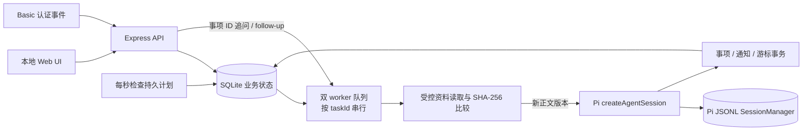

# ADR 001：用 Pi SDK 验证 Always-on Agent

状态：已实现原型。日期：2026-11-17。

## 决策

使用 TypeScript、Node 持久进程、SQLite 和 Express；前端采用原生 HTML/CSS/JS，通过本机 JSON API 每两秒刷新。单用户原型不需要额外的前端构建链、消息代理或独立数据库服务，`npm ci && npm run build && npm start` 即可运行。Node 内置 SQLite 减少原生依赖安装负担，最低版本为 22.19，受 Pi SDK 的引擎要求约束。

模型执行采用 `@earendil-works/pi-coding-agent` **1.5.2**，配合同版本 `@earendil-works/pi-ai`；package.json 精确固定这两个版本，package-lock.json 固定完整依赖树。2026-11-17 通过 `npm view @earendil-works/pi-coding-agent version` 核对可安装版本，再读取安装包的 `examples/sdk/12-full-control.ts`、`dist/core/sdk.d.ts`、`model-runtime.d.ts`、`provider-composer.d.ts` 与 `session-manager.d.ts`，按实际 API 编译和测试。

[上游 SDK 文档](https://github.com/earendil-works/pi/blob/main/packages/coding-agent/docs/sdk.md)及用户提供的本地参考用于理解能力，主线文档没有取代安装包类型。特别是此版本使用 `ModelRuntime`、工具名称 allowlist 和显式 `ResourceLoader`，不能直接套用旧版本的工具对象或 AuthStorage 示例。

## 为什么先用 SDK

首要问题是“持续资料监控是否值得使用”，需要尽快跑通任务、资料变化和用户追问。SDK 已提供 `createAgentSession`、原生 `SessionManager`、流式事件、工具执行、重试与上下文压缩，不需要再写一套模型工具循环。`pi-ai` 只承担 provider 接口，不能替代 Coding Agent 会话能力。

Pi Durable 不是这个原型的第二个执行引擎。首版所有工具只读，运行被打断后可以明确中断、由用户重试，业务调度在 SQLite 中恢复已足够。引入更重的持久执行框架会增加状态边界和调试成本，目前没有可验证的产品收益。

未来出现多进程工作者、跨机器执行、长时间审批等待、精确的多步骤恢复或有外部副作用的工作流时，应重新评估 Pi Durable 或其他持久执行方案。替换的前提应是实际任务需要这些保证，而不是把 JSONL 历史误认为已经有工具级检查点。

## 状态边界

- `taskId` 长期稳定，拥有目标、URL、周期、暂停状态和当前正文游标。
- `runId` 标识一次检查、追问或计划分析，记录触发事件、状态、结果和实际 Pi 会话 ID/路径。
- `itemId` 表示一个新正文版本及其研究事项。`UNIQUE(taskId, hash)` 避免同版本反复通知。
- 每个 item 拥有独立 `sessionId/sessionPath`。周期基线与无变化检查不建会话，新事项才创建，追问与 follow-up 打开已有 JSONL 文件。
- notifications 和 messages 显式保存 task/item/run/session 关联。UI 从通知打开 item，用 itemId 发送问题，不做语义推断。
- events 的全局 eventId 是收件幂等键；收件和运行入队在一个事务提交。followups 记录绝对 dueAt 和派生 runId。
- 业务状态与 Pi 历史不做分布式事务。新会话路径先写入 run，成功结果再以单个 SQLite 事务提交事项、通知、游标和完成状态。崩溃窗口可能产生孤立会话或重复模型费用，但不会出现只推进游标而漏掉通知的半提交。

## 受控 SDK 运行环境

使用项目数据目录下的空 workspace、隔离 agentDir、内存 CredentialStore 和内存 SettingsManager。自定义 ResourceLoader 返回空的扩展、技能、提示模板、项目指令与主题，只提供固定系统提示。工具 allowlist 只有 `read_task_url`，参数为空，实际 URL 由服务端任务提供；不使用 CLI 默认资源发现，不默认加载 MCP。

离线 provider 仍通过 `ModelRuntime.registerProvider()` 和 `createAgentSession()` 执行，产生真实 Pi 会话文件。它只返回固定 fixture，所以能证明 SDK 集成与持久路由，不能证明真实 provider 网络请求和研究质量。单独的公开 URL 读取已做网络 smoke check，自动测试默认保持离线。

## 调度、预算和恢复

单服务进程持有数据目录 PID 锁。调度器每秒将到期任务转为持久 queued 运行；周期任务存在 queued/running 检查时不再追加，错过多次合并为一次。工作者在 await 前标记 running 并占用 taskId，同任务串行，独立任务最多两个并发。

进程启动将遗留 running 标成 interrupted，并同步关联事件与跟进计划。已经 queued 的工作继续；中断工作不会自动重放 Pi 工具现场。恢复时继续使用原事项会话，但是否重试由用户在执行记录中明确触发。所有现有动作只读。后续外部写入必须增加审批与幂等执行记录，不能只依赖 SessionManager。

90 秒运行预算、4 turn 上限、2 次工具读取、有限网络与模型重试限制单次成本。SDK 压缩只处理模型上下文；任务目标、计划和正文哈希不从压缩摘要还原。

## 原型限制

无多用户、分布式租约、精确工具重放、外部通知和审批执行器；不支持浏览器渲染、登录网页或 PDF。不对正文变化做语义相关性过滤。当前为本机单进程、只读任务验证产品价值，而不是提供生产级工作流保证。
